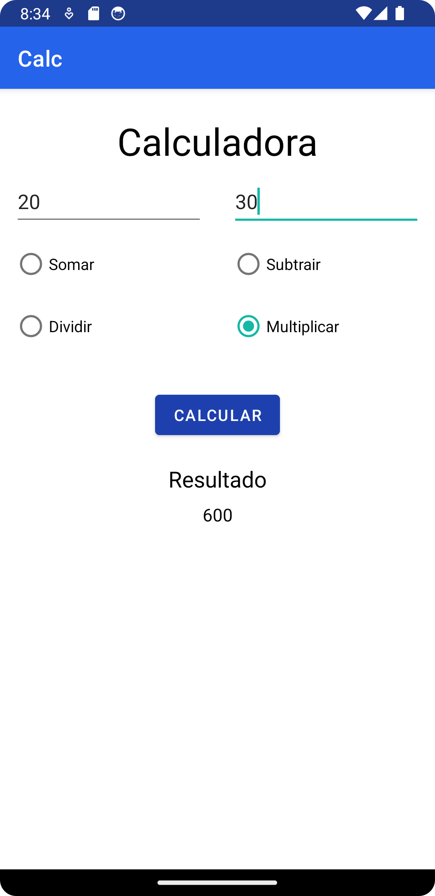

<h1 align="center">Calculadora</h1>

<p align="center">
	English | <a href="README.pt-BR.md">Português (Brasil)</a>
</p>

### Description

A simple Android calculator written in Java. It takes two numbers and applies one of four operations: addition, subtraction, multiplication or division.

The app was developed as a partial requirement for the Introduction to Programming course unit of the Internet Computing technical program (*Técnico em Informática para Internet*) at the Instituto Federal do Norte de Minas Gerais (IFNMG).

> [!NOTE]
> The user interface is in Brazilian Portuguese only (`app/src/main/res/values/strings.xml`); there is no other localization.

### Features

- Two numeric input fields (first and second number).
- Operation selection through radio buttons: add, subtract, divide and multiply.
- Input validation: empty fields show an error on the field, and division by zero shows a message instead of a result.
- Decimal separator follows the device locale (a comma is converted to a dot before parsing).
- Results that are whole numbers are shown without the `.0` suffix.

### Screenshots

<p align="center">
	
</p>

### Tech stack

- Java (source/target compatibility 1.8) and Android, with the AppCompat, Material Components (1.12.0) and ConstraintLayout libraries
- Gradle 8.2 with Android Gradle Plugin 8.2.2

| Setting | Value |
|---|---|
| Application ID | `com.kayo.calc` |
| `minSdk` | 29 (Android 10) |
| `targetSdk` | 30 |
| `compileSdk` | 34 |

### Requirements

- [Android Studio](https://developer.android.com/studio), or the Android SDK with JDK 17 (required by Android Gradle Plugin 8.2)
- An Android 10 (API 29) or newer device or emulator

### How to run

1. Clone the repository:

   ```bash
   git clone https://github.com/Alphka/CalculadoraJava.git
   ```

2. Open the project in Android Studio and let Gradle sync.
3. Select a device or emulator and run the `app` configuration.

To build a debug APK from the command line (requires the Android SDK, with `ANDROID_HOME` or `local.properties` configured):

```bash
./gradlew assembleDebug
```

### Tests

The repository only contains the default template tests (`ExampleUnitTest` and `ExampleInstrumentedTest`); there are no tests for the calculator logic.

### License

[ISC](LICENSE.md) © 2024 Kayo Souza
